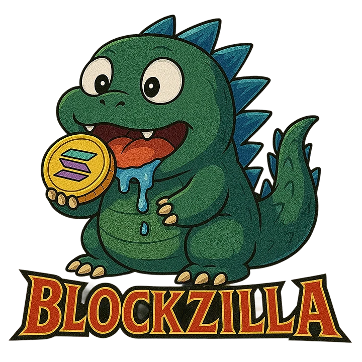

# Blockzilla

**Compact Solana blocks. Live streams. Archive reads.**

Blockzilla provides Compact V2, Zillastream, getBlock, and Rust readers for
applications that need Solana block data.

- [Start here](https://github.com/blockzilla-dev/blockzilla/tree/codex/1.0-core#quick-start)
- [Use the reader SDK](https://github.com/blockzilla-dev/blockzilla/tree/codex/1.0-core/crates/reader/blockzilla-read-sdk)
- [Explore small examples](https://github.com/blockzilla-dev/blockzilla/tree/codex/1.0-core/examples)
- [Read the format](https://github.com/blockzilla-dev/blockzilla/tree/codex/1.0-core/crates/compact-v2)
- [Contribute](https://github.com/blockzilla-dev/blockzilla/blob/codex/1.0-core/CONTRIBUTING.md)

The first 1.0 release is in preparation. The current candidate is
[`codex/1.0-core`](https://github.com/blockzilla-dev/blockzilla/tree/codex/1.0-core).
The combined live token dump and archive backfill remains a development target.

[Source](https://github.com/blockzilla-dev/blockzilla) ·
[Issues](https://github.com/blockzilla-dev/blockzilla/issues) ·
[Website](https://blockzilla.dev)
